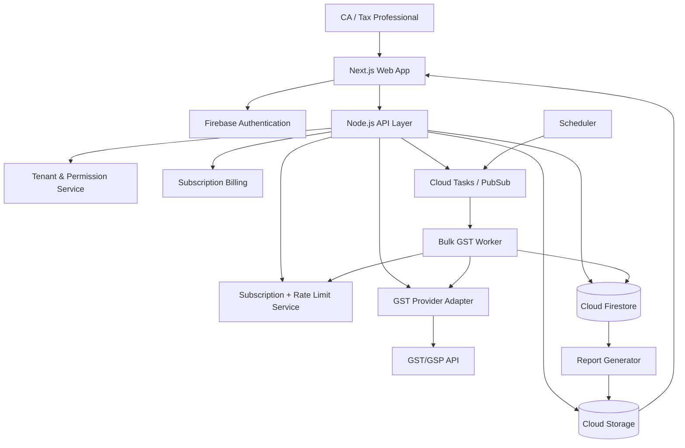

# GST CA Platform — TECH.md

## 1. Product

A multi-tenant SaaS platform for Chartered Accountants (CAs) and tax professionals to manage many GST clients, import GSTINs from CSV, verify GST registrations, inspect GSTR-1/GSTR-3B filing history, monitor compliance, and run recurring checks subject to subscription-based usage limits.

### Primary users
- CA firms
- Individual CAs / tax consultants
- GST practitioners
- Accounting teams
- Optional client/owner portal

### Core design principle
The application must separate **CA subscription limits** from **GST API consumption**. Every GST API request passes through a central usage/rate-limit service so a CA cannot bypass plan limits by calling the provider directly.

---

## 2. Recommended stack

| Layer | Technology | Purpose |
|---|---|---|
| Web app | Next.js + TypeScript | CA dashboard, client management, reports |
| UI | Tailwind CSS + shadcn/ui | Fast professional dashboard UI |
| API | Node.js + TypeScript | Business logic and API orchestration |
| Database | Firebase Cloud Firestore | Multi-tenant operational data |
| Authentication | Firebase Authentication | Email/password, Google, MFA-ready |
| Files | Firebase Cloud Storage | CSV uploads, generated reports |
| Background jobs | Cloud Functions / Cloud Run workers | Bulk GST checks, scheduled monitoring |
| Queue | Cloud Tasks or Pub/Sub | Reliable rate-limited API jobs |
| Cache | Redis / Memorystore, later stage | Provider response cache and distributed rate limiting |
| Payments | Razorpay or Stripe | Indian SaaS subscriptions |
| Email | Resend / Amazon SES | Alerts and transactional emails |
| Notifications | Firebase Cloud Messaging | Optional mobile/push notifications |
| Monitoring | Firebase Crashlytics + Google Cloud Logging | Errors and operational monitoring |
| Analytics | GA4 / Firebase Analytics | Product analytics, with privacy controls |
| Deployment | Firebase Hosting + Google Cloud | Frontend/backend |
| CI/CD | GitHub Actions | Test, build, deploy |

## 3. High-level architecture



## 4. Multi-tenant architecture

Every CA firm is a tenant.

Recommended hierarchy:

```text
Platform
 └── CA Organization
      ├── Users
      │    ├── Owner
      │    ├── Admin
      │    ├── Accountant
      │    └── Viewer
      ├── Clients
      │    ├── GSTINs
      │    ├── Filing history
      │    ├── Checks
      │    └── Documents
      ├── Usage
      ├── Subscription
      └── Audit logs
```

Never rely only on frontend checks. Subscription limits and tenant authorization must be enforced in backend/API middleware and Firestore security rules.

## 5. CSV workflow

1. CA uploads CSV.
2. Validate file type and maximum size.
3. Parse CSV in a worker.
4. Normalize GSTINs.
5. Validate GSTIN format/checksum locally.
6. Remove duplicates.
7. Show import preview.
8. Create import batch.
9. Queue GST verification jobs.
10. Worker processes jobs according to plan rate limits.
11. Store result and provider request metadata.
12. Update dashboard progress.
13. Generate downloadable CSV/Excel report.

Example CSV:

```csv
client_name,gstin,phone,email
ABC Industries,24AAAAA0000A1Z5,9876543210,abc@example.com
XYZ Traders,24BBBBB0000B1Z6,9876543211,xyz@example.com
```

## 6. API security

- Provider API keys only on server-side.
- Never expose GST API keys to browser/mobile clients.
- Encrypt sensitive configuration using Google Secret Manager.
- HTTPS only.
- Firebase App Check where applicable.
- RBAC for every organization.
- Audit sensitive actions.
- Validate and sanitize CSV input.
- Virus/malware scanning for uploaded documents if document uploads are added.
- Request idempotency for bulk jobs.
- Per-tenant quotas.
- Global provider rate limits.
- API retry with exponential backoff.
- Dead-letter queue for failed jobs.

## 7. Rate limiting

Use two independent controls:

### A. SaaS plan limit

Example:

```text
Starter: 500 GST checks/month
Professional: 2,500/month
Firm: 10,000/month
Enterprise: custom
```

### B. Provider/API rate limit

Example provider documentation currently shows 60 requests/minute for GSTIN API. The platform should therefore queue bulk jobs rather than fire thousands of requests simultaneously. Verify provider limits before production integration.

Algorithm:

```text
if monthly_usage >= plan.monthly_gst_checks:
    reject / pause job

if provider_requests_last_minute >= provider_limit:
    delay job

else:
    consume 1 usage unit
    execute provider request
```

Important: consume usage only for an API request that is billable according to the provider's billing rules. Provider errors should not automatically consume a user credit unless the provider bills them.

## 8. Caching

Cache GSTIN responses to reduce unnecessary paid API calls.

Recommended:

```text
GSTIN verification cache: 24 hours to 7 days
Return filing history: configurable, e.g. 24 hours
Compliance dashboard: refresh on demand + scheduled refresh
```

Do not represent cached data as live data. Display:

> Last checked: 06 Oct 2026, 10:20 AM

For compliance-sensitive data, allow a manual "Refresh from GST source" action.

## 9. Observability

Track:

- API latency
- Provider errors
- provider timeout rate
- GST checks/day
- GST checks/CA
- failed CSV rows
- queue depth
- subscription usage
- API cost
- revenue per tenant
- gross margin per plan
- webhook failures

Create alerts for:

- Provider failure > 5%
- Queue backlog > threshold
- API cost spike
- Subscription webhook failure
- Authentication anomalies

## 10. MVP development phases

### Phase 1
- Authentication
- CA organization
- Client CRUD
- GSTIN CRUD
- Single GSTIN verification
- CSV import
- Filing history
- Usage meter
- Basic dashboard

### Phase 2
- Scheduled checks
- GSTR-1/GSTR-3B compliance dashboard
- Bulk export
- Email alerts
- Subscription billing
- Team members
- Audit logs

### Phase 3
- Advanced reconciliation
- Client portal
- White-label reports
- WhatsApp/email reminders
- e-invoice/e-way bill
- API access for CA firms
- Enterprise SLA

## 11. Recommended production approach

Start with:

**Next.js + Node.js/TypeScript + Firebase Auth + Firestore + Cloud Storage + Cloud Tasks + GST API provider.**

Keep GST API integration behind an adapter:

```ts
interface GstProvider {
  verifyGstin(gstin: string): Promise<GstinResult>;
  getReturnHistory(
    gstin: string,
    financialYear?: string
  ): Promise<ReturnHistory>;
}
```

This makes it possible to change GST API vendors without rewriting the application.

---

## Implementation notes (as built — 2026-10-06)

- Layering: `app/api route → server/api.ts wrapper (auth → membership) → services/* (RBAC, subscription, quota) → Store interface → Memory | Firestore`.
- Auth: Firebase ID token verified server-side (`FirebaseAuthVerifier`); `DevAuthVerifier` (`AUTH_MODE=dev`) is refused when `NODE_ENV=production`. Bearer-header auth is not cookie-based, so classic CSRF does not apply.
- One GST check = verify + return history = **one usage unit but two provider requests**. At a 60 req/min provider limit that is ≈30 checks/min (1,000 checks ≈ 33 min). Provider limit value is unverified.
- Queue: not built. Bulk work will run via a job record + bounded-concurrency worker; Cloud Tasks wiring is pending (needs GCP project).
- Cache TTL default 24h; `force` refresh consumes quota.

---

## Implementation notes — milestone 3 (2026-10-06)

### ISSUE-005 — provider throughput (design)
- Cost of one check: verify + return history = **2 provider requests** (1 if `includeReturns=false`). At the spec's 60 req/min (unverified) → ≈30 checks/min full, ≈60/min status-only. 1,000 checks ≈ 33 min / 17 min. `/api/bulk-checks/preview` reports `estimatedSeconds`.
- `src/config/provider.ts` holds the limits (env-driven, flagged `verified:false`). `src/providers/gate.ts` (`ResilientProvider`) is the ONLY place that enforces them: circuit breaker → concurrency semaphore → sliding-window req/min → timeout → retry (exponential backoff, full jitter, `Retry-After`). Unknown errors are converted to generic `ProviderError`s.
- Circuit breaker = the "provider unavailable" state: N consecutive timeout/unavailable failures open it; while open, calls fail fast (`GST_PROVIDER_UNAVAILABLE`, no provider request, non-billable); after a cooldown one trial request half-opens it.

### Bulk processing
```text
POST /api/bulk-checks → resolve selection (org-scoped) → idempotency claim → atomic quota HOLD (live items only)
  → job + items stored → queue.enqueue
worker (resumable): claim items queued→processing (atomic) → CheckService(held) via gate → finish item (settled once)
  → settle quota (consume | release) → finalize (reconcile leaked holds, final status, alert)
```
Quota vocabulary: *requested* (live-needed items) → *reserved* (held) → *consumed* (billable success) / *released* (cached, non-billable failure, cancelled, abandoned). `remaining = limit − used − reserved`. Items expected to be cached are not held; if their cache expires before processing, one unit is held lazily.
Queue: `JobQueue` interface; `InProcessQueue` today (dev/test; **not serverless-safe**). Production target: Cloud Tasks → internal endpoint calling `BulkService.processJob`, which is idempotent and resumable (`/resume` re-queues stuck items).
Settlement ordering: finish-then-settle, so a crash leaks a hold (under-charge) rather than double-charging; `finalize` reconciles leaks.

---

## Implementation notes — milestone 4: frontend (2026-10-06)

- **Stack:** Next.js App Router (client components for the authenticated app), Tailwind 4 tokens in `globals.css`, Radix primitives for Dialog / Dropdown / Tooltip / Tabs (focus trap, roving focus, ARIA for free), SWR for data, lucide-react icons, Inter. No UI kit; components live in `src/components/ui`.
- **Data flow:** page → `useApi(path)` (SWR, key = `[path, activeOrgId]`, so switching organization can never show another organization's cache) → `api()` (adds `Authorization: Bearer <token>` and `X-Organization-Id`, unwraps `{success,data}`, maps errors to `ApiError`, dispatches an unauthorized event on 401). Mutations use `useApiCall()` then `useInvalidate(prefixes)`.
- **Auth:** `AuthClient` interface with `dev` / `firebase` / `unconfigured` implementations (`src/lib/client/auth-client.ts`). Dev is selected by `NEXT_PUBLIC_AUTH_MODE=dev` or missing Firebase env, and is impossible in production builds (they get `unconfigured`, which fails closed but lets the site build). The server's `AUTH_MODE=dev` verifier accepts the dev token format `dev:<uid>:<email>[:unverified]`.
- **Protected routes:** `(app)/layout` renders `AppFrame` → `AuthGate` (redirects signed-out → `/login?next=`, no-org → `/onboarding`). This is UX only; every API call re-checks membership, role, subscription and quota on the server.
- **Role-aware UI:** navigation and actions are hidden using the same `can()` matrix as the server (`src/lib/permissions.ts`); the API remains the authority.
- **Responsive:** sidebar ≥ lg, drawer + bottom tab bar below; `DataTable` renders cards below md so nothing scrolls horizontally.
- **Accessibility measures:** skip link, landmark roles, visible focus ring, labelled controls (`Field`), `aria-current`, combobox pattern for search, status = icon + text, polite live regions for toasts, `role="alert"` only for errors, reduced-motion respected, AA-safe text tokens. Verified with axe-core (WCAG 2.0/2.1 A+AA) on the main screens; not yet verified with a screen reader.
- **Known limits:** light theme only; app pages are client-rendered (no per-page `<title>` yet); notifications are computed from the dashboard (no read state, no email); bulk multi-select is desktop-only.

---

## Implementation notes — milestone 5: CSV import (2026-10-06)

```text
CSV → parse (RFC 4180, BOM/CRLF/quotes) → normalize → validate (GSTIN checksum, name/email/phone) → de-duplicate (file + org)
    → PREVIEW (stateless) → CONFIRM → start: claim idempotency key → capacity check → store validated rows in 500-row chunks → record → enqueue(kind="import")
    → worker: per chunk { re-check subscription + plan room, skip rows that already exist/over limit, create clients + GSTIN records (bounded concurrency 10, deterministic ids), commit counters + nextChunk }
    → finish: status, audit CSV_IMPORTED, alert IMPORT_COMPLETED
    → (optional) BulkService.create(importedClientIds, Idempotency-Key "import-<id>") → existing queue / quota hold / provider gate
```
- **One idempotency mechanism** (`src/lib/idempotency.ts`) is shared by bulk checks and imports. Rule: claim the key BEFORE state-dependent checks; release (compare-and-delete) on any rejection; a claim without a record means "in progress" (waiters retry, steal only after 60 s).
- **Queue:** `JobQueue.enqueue({orgId, jobId, kind})`. `InProcessQueue` today (dev/test; not serverless-safe — ISSUE-006). A Cloud Tasks implementation would POST an authenticated internal endpoint that calls `ImportService.process` / `BulkService.processJob`; both are resumable.
- **Failure semantics:** crash mid-chunk ⇒ counters unchanged, clients already created are recognised by deterministic id on resume; subscription lapse or lost permission ⇒ import `failed` with a safe `errorCode`, nothing further is created.
- **Memory/size:** a 5 MB / 20,000-row file is parsed once per preview and once per start; only validated rows are persisted (chunked), never the raw file. Reading the org's existing GSTIN set is O(clients) (tech debt for very large firms).
- Browser side: pure helpers in `src/lib/client/import-wizard.ts` (file validation, header/mapping detection, sample CSV); the wizard sends the CSV text as JSON and uses a per-file `Idempotency-Key` so double-clicks and retries are safe.
